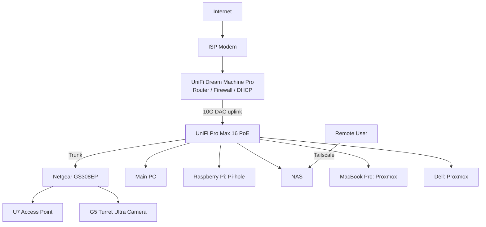

# Network Infrastructure and Segmentation

I rebuilt my home network on UniFi equipment with a Netgear PoE switch trunked into it. The goals were isolation between device types, central management, and a clean physical layout in a small rack.

## Hardware

| Device | Role |
|---|---|
| UniFi Dream Machine Pro | Gateway: router, firewall, DHCP, UniFi Network controller |
| UniFi Pro Max 16 PoE | Core managed switch, 10G DAC uplink to the gateway |
| Netgear GS308EP | PoE switch for the access point and camera, trunked to the UniFi switch |
| UniFi U7 | Wi-Fi access point |
| UniFi G5 Turret Ultra | Security camera |
| UniFi Power Distribution Pro | Rack PDU, powers the network gear |
| Toolless Mini Rack, fixed shelf | Rack and shelf for servers |
| 24-port keystone patch panel, Cat6 couplers | Structured cabling |

**Servers on the shelf:** UGREEN 2-bay NAS, Raspberry Pi (Pi-hole), MacBook Pro (headless Proxmox), Dell (headless Proxmox).

## Rack Layout (top to bottom)

```
[ Shelf: NAS | Raspberry Pi | MacBook Pro | Dell ]
[ 24-port keystone patch panel                   ]
[ UniFi Pro Max 16 PoE switch                    ]
[ UniFi Dream Machine Pro                        ]
[ UniFi Power Distribution Pro                   ]
```

## Topology



## VLANs and Firewall Policy

| VLAN | Purpose | Policy |
|---|---|---|
| Management | Network device administration | TODO: describe access rules |
| Main | Primary computers | TODO: describe access rules |
| Main Wi-Fi | Trusted wireless devices, authenticated via RADIUS | TODO: describe access rules |
| Servers | NAS, Pi-hole, Proxmox hosts | Cannot initiate connections to other VLANs; return traffic allowed |
| IoT | Smart/IoT devices | Isolated from all other VLANs; exception: DNS to Pi-hole |
| Guest | Guest Wi-Fi | Isolated from all other VLANs; exception: DNS to Pi-hole |

DHCP is handled by the gateway. Pi-hole provides DNS for every VLAN.

## What I Learned

- Trunking between two vendors (UniFi and Netgear) takes careful matching of tagged and untagged VLANs. Getting it wrong can lock you out of a switch.
- Firewall rules are evaluated in order, and "isolated" VLANs still need explicit exceptions for things like DNS.
- Always back up the gateway and switch configs before making big changes.

See the [Troubleshooting Log](../troubleshooting-log/) for the specific problems I ran into.

> **TODO:** Add a screenshot of the UniFi network topology and the VLAN list (hide IPs and MACs).
